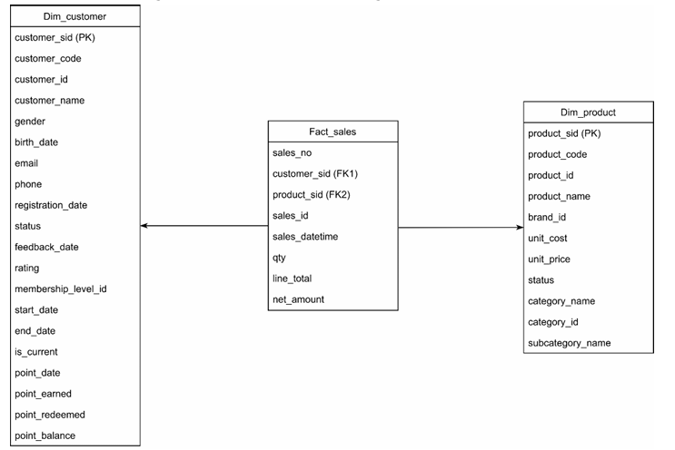

# Retail Data Warehouse & ETL

A dimensional data warehouse in SQL Server for a retail company, built to analyze customer retention KPIs. Group project (team of 4), Information Systems, Universitas Tarumanagara, 2026.

**My role:** Built the data warehouse structure (database, schemas, and tables) and implemented the core ETL process: data cleansing and standardization, initial load, incremental load, and Slowly Changing Dimensions (Type 1 and Type 2).

## Business Problem

PT Nusantara Retail Indonesia, a case-study retail company, runs separate systems for POS, inventory, customer loyalty, and finance. Because the data is siloed, customer profiles in the loyalty system could not be linked to their purchases in the POS system, so retention decisions depended on slow, manual data pulls. This project builds a centralized data warehouse that integrates these sources to measure customer retention KPIs such as purchase frequency, average transaction value, and retention rate by quarter.

**Focus KPI:** Customer Retention (purchase frequency, average transaction value, total spending per customer, product affinity by tier, and retention rate by quarter).

## Data Warehouse Design

The warehouse is organized into three schemas:

| Schema | Purpose |
|---|---|
| `Ekstraksi` | Raw data extracted from source files |
| `Transformasi` | Cleaned and standardized data |
| `Loading` | Final dimension and fact tables |

## What I Built

- **Data cleansing:** handled missing emails and phone numbers, trimmed extra spaces in feedback comments, fixed negative point values, removed cancelled and incomplete sales records, and corrected products priced below their cost.
- **Standardization:** consistent text casing for feedback comments and consistent product naming.
- **Initial load:** built `fact_sales`, `dim_customer`, and `dim_product` from the cleaned tables, using surrogate keys.
- **Slowly Changing Dimensions:** Type 1 for customer and product attributes (overwrite), Type 2 to keep the full history of membership level changes.
- **Incremental load:** loads only new customer point records based on the last loaded date.
- **Analytical queries:** top-selling products and membership analysis.

## Key Findings

- Repeat purchases stayed between 496 and 568 transactions per month in 2025.
- High-value customers were mostly Bronze tier, so tenure and purchase frequency mattered more than membership level.
- FMCG items (Mie Sedaap Goreng, Chitato Sapi Panggang) drove the most sales volume.

*Findings are from the full project report (see below).*

## How to Run

1. Run `01_create_database_schemas.sql` to create the database and schemas.
2. Load the source tables into the `Ekstraksi` schema (source data is not included, see below).
3. Run the scripts in numeric order, from `02` to `08`.

## Data

The source data is simulated data created for coursework and is not included in this repository. The scripts show the table and column structure expected by the ETL.

## Tech Stack

SQL Server, T-SQL, SSMS, draw.io

## Full Report

[Read the full project report (PDF, in Indonesian)](docs/Laporan_Proyek_DW.pdf)
